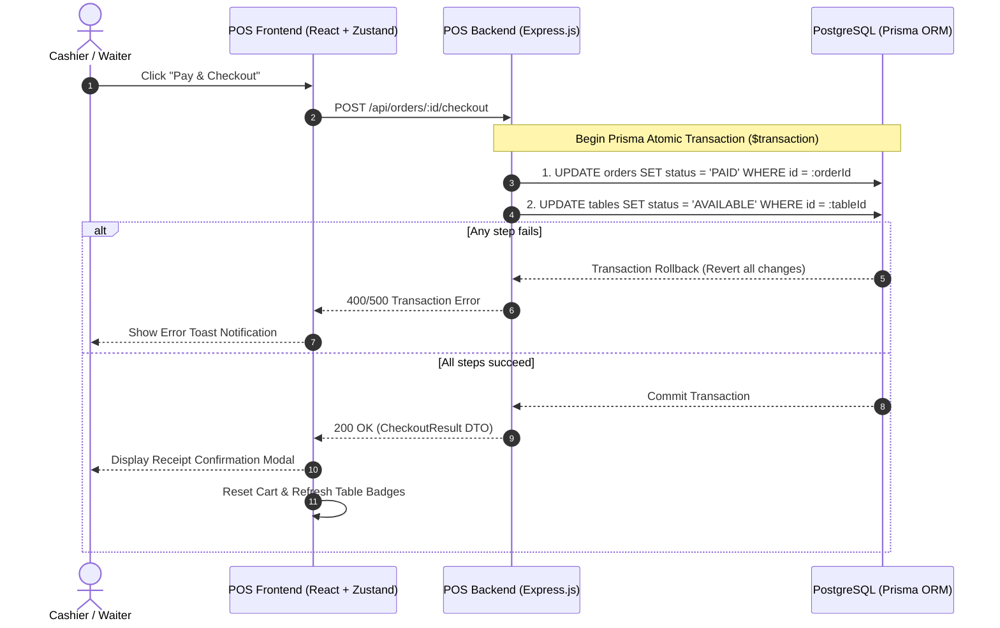
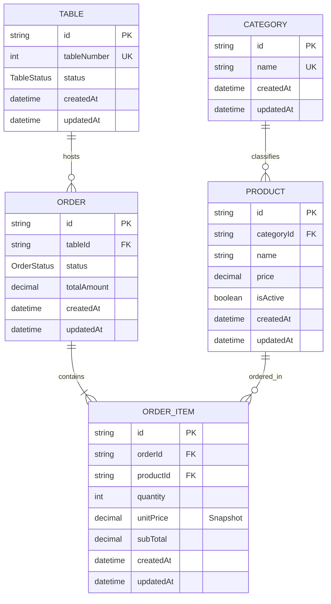

# 🍽️ GourmetPOS - Full-Stack Restaurant Point of Sale System

[](https://www.typescriptlang.org/)
[](https://reactjs.org/)
[](https://nodejs.org/)
[](https://expressjs.com/)
[](https://www.postgresql.org/)
[](https://www.prisma.io/)
[](https://tailwindcss.com/)
[](https://zustand-demo.pmnd.rs/)

A portfolio-grade, production-ready, decoupled **Restaurant Point of Sale (POS)** application engineered with clean layered architecture, separation of concerns, and robust transactional data integrity.

---

## 📸 Key Features

- **Decoupled Architecture:** Autonomous backend REST API and frontend Single Page Application (SPA).
- **Atomic Checkout Transactions:** Handled via Prisma's `prisma.$transaction`. When an order is paid, the order status changes to `PAID` and the associated table status is released to `AVAILABLE` simultaneously in a single atomic step with rollback protection.
- **Price Snapshot Integrity:** When adding items to an order, the active product price is copied directly into `OrderItem.unitPrice`. Even if a restaurant modifies menu prices later, historical revenues remain 100% accurate.
- **Soft Delete Pattern:** Menu products use `isActive: Boolean`. Inactive items are excluded from active ordering but preserved for historical receipts.
- **Two-Panel Responsive Kiosk UI:**
  - **Left Panel:** Search bar, category filters, and interactive product cards with click-to-add micro-interactions.
  - **Right Panel:** Live order cart, quantity increments (`+`) and decrements (`-`), trash removal, live tax breakdown, and dynamic Grand Total.
- **Manager Security PIN Pad:** Protected administration modal requiring a 4-digit Manager PIN (`1234`) to add tables, add products, or archive menu items.
- **Order History & Receipts:** Visual receipt archive modal listing all past completed orders, timestamps, table numbers, itemized lists, and totals.
- **Auto-Incrementing Table Management:** Single-click table creation that automatically calculates the next available table number.

---

## 🏛 Architecture & Workflow

### Decoupled System Architecture

```
adisyonSistemi/
├── backend/                       # REST API (Express.js + TypeScript + Prisma ORM)
│   ├── prisma/
│   │   ├── schema.prisma         # PostgreSQL Schema & Indexes
│   │   └── seed.ts               # Database Seed (12 Tables, 5 Categories, 19 Products)
│   ├── src/
│   │   ├── config/               # Prisma singleton & environment
│   │   ├── controllers/          # HTTP request handlers
│   │   ├── services/             # Business logic & atomic transactions
│   │   ├── routes/               # Modular API endpoint definitions
│   │   ├── middlewares/          # Validation, error handling, logging
│   │   ├── schemas/              # Zod input validation schemas
│   │   └── types/                # Domain & DTO TypeScript interfaces
│   ├── .env.example
│   ├── package.json
│   └── tsconfig.json
├── frontend/                      # Client Application (React + TypeScript + Vite)
│   ├── src/
│   │   ├── components/
│   │   │   ├── common/           # Toasts, spinner
│   │   │   ├── layout/           # Header, TableSelector, AdminModal, OrderHistoryModal, PinAuthModal
│   │   │   ├── menu/             # CategoryNav, ProductCard, MenuSection
│   │   │   └── cart/             # CartItemRow, CartPanel, CheckoutModal
│   │   ├── stores/               # Central Zustand store (usePosStore.ts)
│   │   ├── services/             # Axios API client (api.ts)
│   │   ├── types/                # Frontend TypeScript models
│   │   └── index.css             # Tailwind base & custom POS scrollbars
│   ├── tailwind.config.js
│   ├── package.json
│   └── tsconfig.json
├── docker-compose.yml             # Local PostgreSQL Docker service
├── package.json                   # Root orchestrator (concurrently)
└── README.md
```

### Atomic Checkout Sequence



---

## 🗄️ Database Schema & Relational Model

The database models are written in **Prisma ORM** for PostgreSQL:



---

## 📡 REST API Reference

All endpoints return responses in a standardized JSON envelope:
`{ "success": boolean, "data": T, "message"?: string, "timestamp": string }`

### Tables
| Method | Endpoint | Description |
| :--- | :--- | :--- |
| `GET` | `/api/tables` | Retrieve all tables with active order info |
| `GET` | `/api/tables/:id` | Get single table details |
| `POST` | `/api/tables` | Create next table (auto-increments number) |
| `DELETE` | `/api/tables/:id` | Delete table (blocks if active order exists) |
| `PATCH` | `/api/tables/:id/status` | Update table status (`AVAILABLE` / `OCCUPIED`) |

### Categories & Products
| Method | Endpoint | Description |
| :--- | :--- | :--- |
| `GET` | `/api/categories` | Retrieve all categories |
| `GET` | `/api/products` | Retrieve active products (supports `?categoryId=...`) |
| `POST` | `/api/products` | Create new product (validated via Zod) |
| `PATCH` | `/api/products/:id` | Update product details |
| `DELETE` | `/api/products/:id` | Soft-delete product (`isActive: false`) |

### Orders & Checkout
| Method | Endpoint | Description |
| :--- | :--- | :--- |
| `GET` | `/api/orders` | Retrieve order history (supports `?status=PAID`) |
| `GET` | `/api/orders/active/table/:tableId` | Get open order for a specific table |
| `POST` | `/api/orders` | Open new order or append items (captures price snapshot) |
| `PATCH` | `/api/orders/:orderId/items/:itemId` | Update quantity (0 deletes item, recalculates totals) |
| `POST` | `/api/orders/:id/checkout` | ⭐ **Atomic checkout transaction** (`PAID` + `AVAILABLE`) |
| `POST` | `/api/orders/:id/cancel` | Cancel order and release table |

---

## 🚀 Getting Started

### Prerequisites
- [Node.js](https://nodejs.org/) v18+ (Tested on v24)
- [Docker](https://www.docker.com/) & Docker Compose

### 1. Clone & Install Dependencies
```bash
git clone https://github.com/ITSDeniz/fullstack-restaurant-pos.git
cd fullstack-restaurant-pos

# Install root orchestrator and packages
npm install
npm --prefix backend install
npm --prefix frontend install
```

### 2. Start PostgreSQL Database
```bash
docker compose up -d
```
> Note: Docker maps to host port `5433` to prevent conflicts with any native PostgreSQL running on port `5432`.

### 3. Setup Database Schema & Seed Data
```bash
cd backend
npx prisma db push
npm run prisma:seed
cd ..
```

### 4. Run the Full Stack Application
From the root directory, run both Backend API (`http://localhost:5050`) and Frontend Kiosk (`http://localhost:5173`) concurrently:
```bash
npm run dev
```

Open your browser at:
👉 **[http://localhost:5173](http://localhost:5173)**

---

## 🔐 Security & Manager Authentication

To access the POS Administration modal:
1. Click the **`Manage`** button in the header.
2. Enter the default 4-digit Manager PIN:
   - **Default PIN:** `1234`
3. Unlock options to add tables, add products, or archive menu items.

---

## 🛠️ Tech Stack Breakdown

- **Frontend:** React 18, TypeScript, Tailwind CSS, Lucide Icons, Vite, Axios.
- **State Management:** Zustand (reactive store, persistent table selection, optimistic UI).
- **Backend:** Node.js, Express.js (Layered Controller-Service Architecture).
- **Validation:** Zod (Strict schema validation on HTTP boundaries).
- **Database & ORM:** PostgreSQL 16, Prisma ORM (`prisma.$transaction`, Decimal type handling, soft deletes).
- **DevOps:** Docker, Docker Compose, Concurrently.

---

## 📄 License
This project is open-source and available under the [MIT License](LICENSE).
